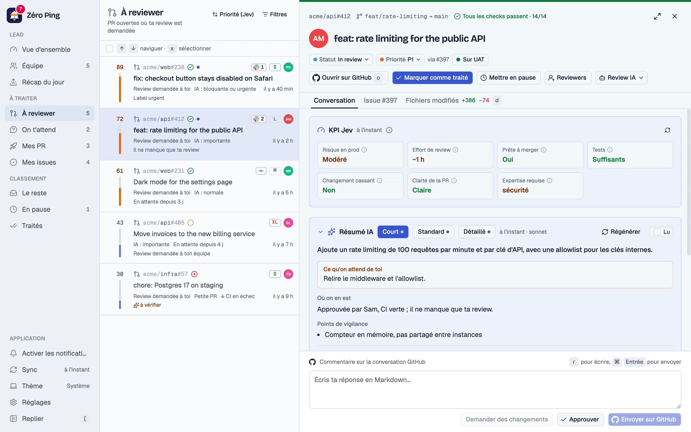
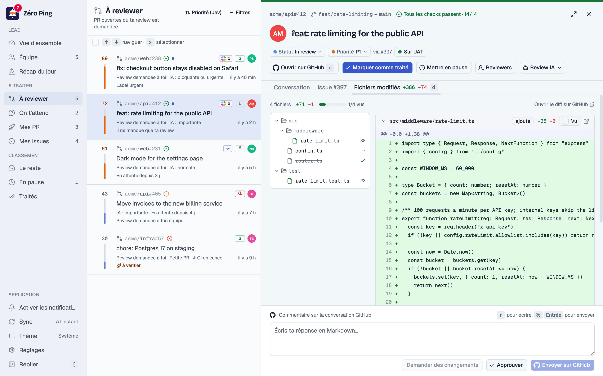
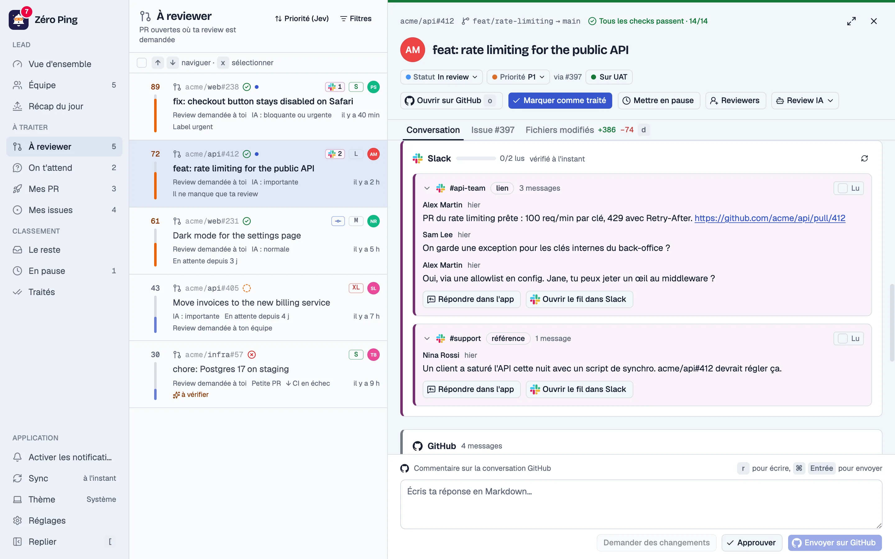
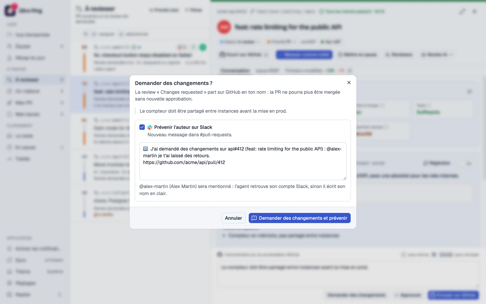
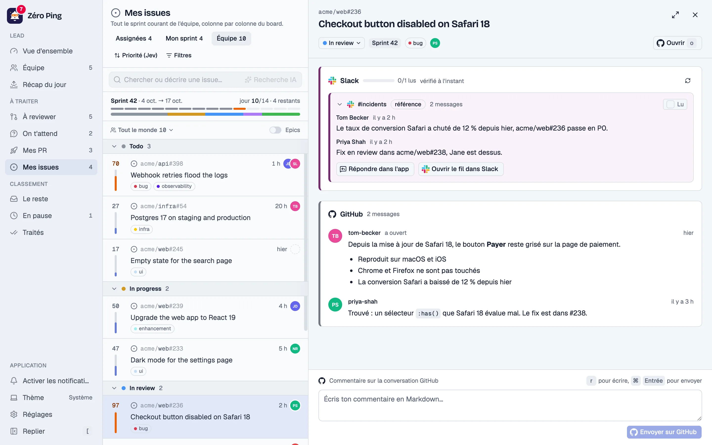
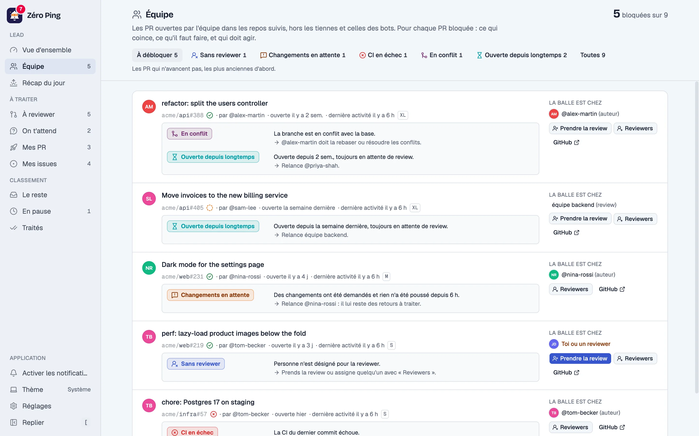
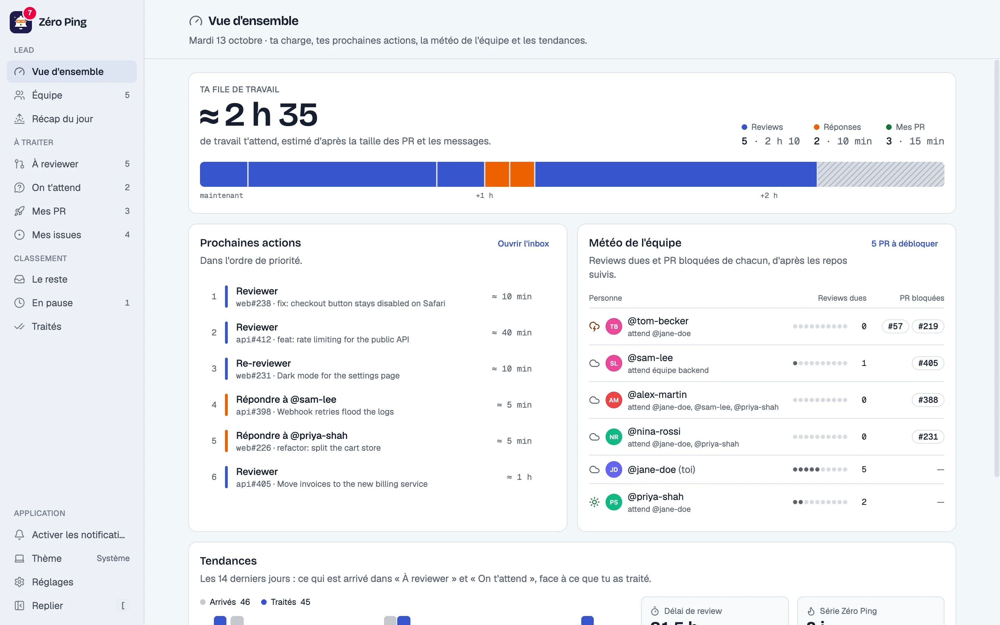
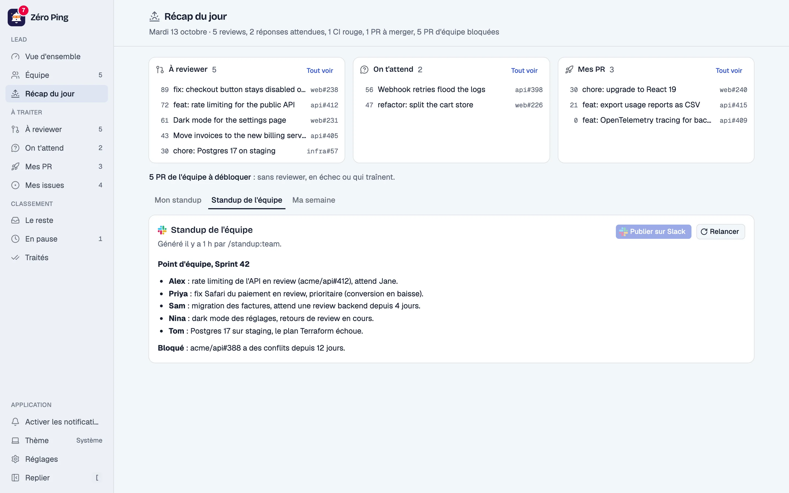
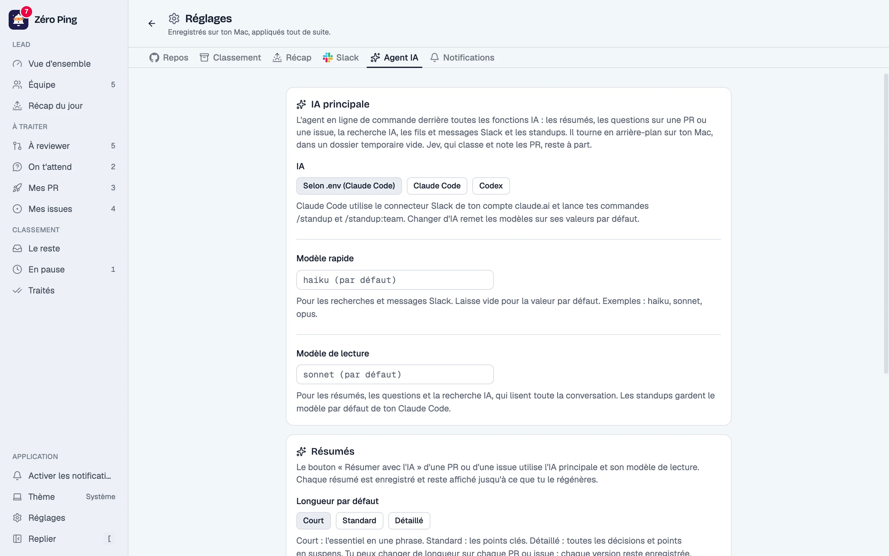

<div align="center">


# Zéro Ping

**A local inbox for lead developers: GitHub notifications, Slack threads and your sprint, triaged and ranked, so nothing waits on you.**

[Features](#features) · [Quick start](#quick-start) · [Configuration](#configuration) · [macOS app](#macos-app) · [Privacy](#privacy) · [Development](#development) · [FAQ](#faq) · [Français](README.fr.md)

<picture>
  <source media="(prefers-color-scheme: dark)" srcset="docs/screenshots/inbox-dark.webp" />
  
</picture>

</div>

Zéro Ping replaces GitHub notification emails with a ranked list of what actually needs you: reviews to give, replies people are waiting for, your own PRs, your sprint. Every item carries a priority score you can read, the Slack threads that mention it, an AI summary, and the actions to close it without leaving the app.

It runs on your machine, uses your `gh` login and your coding agent (Claude Code or Codex), and stores everything in a local database. The interface is in French.

> The screenshots come from the built-in [demo mode](#demo-mode): fictional people and repositories, nothing read from or sent to GitHub, Slack or an AI.

## Features

### Inbox

- **Folders that mean something.** « À reviewer » (PRs where your review is requested, directly or through a team), « On t'attend » (mentions and review threads where someone answered after you), « Mes PR » (yours, with CI and review decision, or every open PR of the tracked repos), « Mes issues », « Le reste », « En pause » and « Traités ».
- **Explained priority.** Each item gets a 0–100 score from its age, a missing last reviewer, size, CI, urgent labels and Jev's urgency estimate. Hover the score to see why.
- **Jev ranking and KPI cards.** Jev (TypeSafe's decision model) ranks the lists and gives each PR a set of KPI cards: production risk, review effort, ready to merge, tests, breaking change, clarity, required expertise. Issues get their own: size, impact, blocked, needs a decision… Without a key, deterministic rules rank alone.
- **Re-reviews.** When commits land after your review, the PR is flagged and the diff can be limited to those commits. If you had requested changes, it comes back to « À reviewer ».
- **Auto-triage.** Merged or closed PRs, bots, CI activity, releases and authors of your choice go to « Traités » on their own, without ever touching what waits for you.
- **Keyboard first.** `j`/`k` to move, `e` done, `x` select, `r` reply, `o` open on GitHub, `d` diff, `[` sidebar. Batch actions on a selection.
- **Ping counter** on the sidebar logo, the tab title (`(5) Zéro Ping`), the favicon and the macOS Dock icon, plus browser notifications for new reviews, awaited replies, requested changes and red CI.

### Pull request panel

<picture>
  <source media="(prefers-color-scheme: dark)" srcset="docs/screenshots/diff-dark.webp" />
  
</picture>

- **Header at a glance:** branches, checks (`14/14`), project status and priority from GitHub Projects (editable), linked issue, and whether the PR runs on the `uat` branch.
- **Conversation** from GitHub, Slack or both, **changed files** with a file tree and « Vu » boxes synced with GitHub, the **linked issue** in its own tab.
- **Act from the app:** reply (comment or review thread, with `@mentions`), approve or request changes, request reviewers, trigger an AI review (`@codex review`, `@claude review`, `/gemini review`, configurable), merge with the method of your choice, read failed CI jobs and their logs, re-run failed GitHub Actions jobs, mark done or snooze.

### AI, through your own coding agent

- **AI summaries** in three lengths (short, standard, detailed): the gist, where it stands, what is expected from you, open questions and risks. Stored, flagged « Pas à jour » after new activity, regenerated on demand.
- **Ask the AI** about a PR or an issue: it reads the conversation, the Slack threads, the diff, the Jev KPIs, the project status and the `uat` state.
- **AI search** in plain words over the PR and issue lists (« les PR qui touchent la facturation »).
- **The main AI is your choice:** Claude Code (`claude -p`) or Codex (`codex exec`), each with a fast model (Slack) and a reading model (summaries, questions, search). They run headless, without tools, in an empty temporary folder.

### Slack

<picture>
  <source media="(prefers-color-scheme: dark)" srcset="docs/screenshots/slack-dark.webp" />
  
</picture>

- **Threads per PR and issue.** The agent searches Slack for messages citing the item (link, `repo#123` reference or subject) and shows the full threads, with a `#` badge in the list and read marks per thread.
- **Reply in the app:** the agent posts your text in the thread, as you.
- **Review with a Slack notice:** after approving or requesting changes, Zéro Ping drafts the message that tells the author, in the PR's thread when there is one, and mentions them.

<picture>
  <source media="(prefers-color-scheme: dark)" srcset="docs/screenshots/review-dark.webp" />
  
</picture>

### « Mes issues » and the sprint board

<picture>
  <source media="(prefers-color-scheme: dark)" srcset="docs/screenshots/sprint-dark.webp" />
  
</picture>

Your assigned issues, your sprint and the whole team sprint from a GitHub Projects (v2) board, grouped by column, ranked by Jev, with sprint progress, epics toggle, filters, and status changes from the panel. The project is picked from the page when there are several.

### Team view, overview and daily recap

<picture>
  <source media="(prefers-color-scheme: dark)" srcset="docs/screenshots/team-dark.webp" />
  
</picture>

- **Équipe:** open PRs of the tracked repos without a reviewer, with pending changes, red CI, conflicts or open too long, each with what blocks it, who holds the ball, and « Prendre la review » in one click.
- **Vue d'ensemble:** your workload in minutes, next actions in order, the team's weather, the 14-day flow, median review delay and your Zéro Ping streak.
- **Récap du jour:** every working day at the time you choose, a notification sums up what waits for you, and your standup and the team's (`/standup`, `/standup:team`) are drafted by the agent, ready to post in today's reminder thread on Slack. « Ma semaine » lists what you shipped, started, reviewed and closed.
- **Ne pas déranger:** mute for an hour, until tomorrow, or every evening with quiet hours.

<table>
  <tr>
    <td><picture><source media="(prefers-color-scheme: dark)" srcset="docs/screenshots/dashboard-dark.webp" /></picture></td>
    <td><picture><source media="(prefers-color-scheme: dark)" srcset="docs/screenshots/recap-dark.webp" /></picture></td>
  </tr>
</table>

## Requirements

| | |
| --- | --- |
| **Node.js** 22+ and **pnpm** | to install and run the app |
| **GitHub CLI** (`gh`), logged in | the GitHub token comes from `gh auth token` (or `GITHUB_TOKEN`) |
| **Claude Code** with the claude.ai **Slack connector**, or **Codex** with a **Slack MCP server** | all AI features and the Slack search. Optional: without an agent, the inbox, the team view and the board still work |
| **TypeSafe API key** (Jev), optional | Jev ranking and KPI cards. Without it, deterministic rules rank alone |
| macOS, optional | for the Dock app; the web app runs anywhere Node does |

## Quick start

```sh
git clone https://github.com/Alexandredc/zero-ping.git
cd zero-ping
pnpm install
cp .env.example .env   # optional: TYPESAFE_AI_API_KEY for Jev
pnpm dev               # http://localhost:3000
```

The first sync reads the last 30 days of notifications. Then open **Réglages** to pick the repositories to track and your main AI.

For daily use, build once and run the production server: `pnpm build && pnpm start` (port 3000, or `PORT`), or install the [macOS app](#macos-app).

### Demo mode

```sh
pnpm demo              # http://localhost:3100
```

Starts the app on fictional data (the Acme team, `acme/api`, `acme/web`, `acme/infra`, Jane Doe and her colleagues) in its own data folder, `.data/demo`. Nothing is read from or sent to GitHub, Slack, Jev or an AI: those calls fail with « Mode démo » and the demo answers from fixtures. Local actions (done, snooze, read marks, settings) work. The data is reseeded at every start, dated from that moment.

## Configuration

### `.env`

Keys and tokens live in `.env` (see [`.env.example`](.env.example)):

| Variable | Effect |
| --- | --- |
| `GITHUB_TOKEN` | GitHub token; by default the `gh` CLI's |
| `TYPESAFE_AI_API_KEY` | Enables Jev |
| `AI_DECISION_MODEL` | `typesafe:<model>` (default `typesafe:jev-latest`) or `anthropic:<model>` with `ANTHROPIC_API_KEY` |
| `AGENT_CLI` | Main AI: `claude` (default) or `codex` |
| `AGENT_MODEL` | Fast model of the main AI (default `haiku` for Claude, your config for Codex) |
| `AGENT_COMMAND` | Path to the agent's executable when it is not on the `PATH` |
| `SLACK_AGENT_TOOLS` | Slack tools allowed for Claude Code, with another Slack MCP server |
| `SLACK_AGENT_SEND_TOOL` | Slack send tool for Claude Code, with another Slack MCP server |
| `SLACK_SEARCH` | `off` disables the Slack search |
| `DATA_DIR` | Where PGlite stores its data (default `.data/pglite`) |

### Réglages

<picture>
  <source media="(prefers-color-scheme: dark)" srcset="docs/screenshots/settings-dark.webp" />
  
</picture>

Everything else is set in the app and saved in the local database, where it overrides `.env`:

- **Repos:** tracked repositories, add one, filter.
- **Classement:** auto-triage rules, authors to file away, the team view's age threshold.
- **Récap:** daily recap and its time, standups (Slack channel, reminder text, commands).
- **Slack:** background search, excluded channels, the review notice and its channel.
- **Agent IA:** main AI (Claude Code or Codex), fast and reading models, default summary length, Jev and GitHub status.
- **Notifications:** browser permission, kinds, sync interval, do-not-disturb and quiet hours.

### Slack access

The Slack search runs through your coding agent, with **your** Slack access:

- **Claude Code** (default): uses the Slack connector of your claude.ai account. Nothing to configure if `claude` is logged in and the connector is enabled.
- **Codex:** set `AGENT_CLI=codex` (or choose it in Réglages > Agent IA), then add a Slack MCP server: `codex mcp add slack --url <Slack MCP server URL>` and `codex mcp login slack`.

A search takes 30 s to 1 min and costs about $0.02 with Haiku. Results are kept 6 hours; at most three PRs are searched per sync, one at a time. A Slack app with a personal token is an agent-free alternative: see [docs/slack-app.md](docs/slack-app.md) (in French).

## macOS app

```sh
scripts/macos-app.sh   # creates ~/Applications/Zéro Ping.app (or in the folder you pass)
```

The app starts the server on port 4747 when it is not running (building first if the sources changed) and opens http://inbox.localhost:4747. Clicking its Dock icon brings the open Zéro Ping tab to the front (Dia, Chrome, Arc, Brave, Edge or Safari) instead of opening a new one, and its badge shows the ping count. Quitting it (⌘Q) stops the server. Run the script again if you move the repository: it records the repo path and your `PATH` (pnpm, gh, claude).

From a terminal, `scripts/server.sh start|stop|status` does the same.

## Privacy

- **Everything runs locally.** The production server binds to `127.0.0.1`; the data (items, summaries, Slack threads, settings) stays in a PGlite database under `.data/`, which is git-ignored.
- **No backend of ours.** Zéro Ping talks to GitHub with your token, to Jev only when a subject's content changed (its hash is stored), and to Slack and the AI only through the coding agent installed on your machine, with your own accounts.
- **Read-only by default.** The Slack agent only gets search and read tools; writing (a reply, a review notice, a standup) only happens when you click.
- **The agent runs without tools** for summaries, questions and search, in an empty temporary folder.

## How it works

- The server polls `/notifications` at the interval GitHub asks for (`X-Poll-Interval`, usually 60 s) with `If-Modified-Since`: 304 answers cost no quota. A `review-requested:@me` search completes it every 5 minutes.
- Changed subjects are enriched through GraphQL (a light pass for the state, then the details of open subjects) and scored.
- Jev is only called when a subject's content changes.
- The interface reads the local database every few seconds; the PR panel is stale-while-revalidate.

**Stack:** TanStack Start, Router and Query, React 19, shadcn/ui on Base UI, Tailwind CSS v4, PGlite with Drizzle ORM 1.0, AI SDK (`experimental_decide` with Jev), Octokit.

## Development

```sh
pnpm dev               # dev server on port 3000
pnpm demo              # dev server on fictional data, port 3100
pnpm test              # Vitest
pnpm typecheck
pnpm lint
pnpm format            # Prettier
pnpm db:generate       # new migration after a schema change
pnpm screenshots       # regenerate docs/screenshots
```

Migrations run at startup. PGlite accepts one process per data folder: stop the app before running `drizzle-kit` on `.data/pglite`.

### Screenshots

`pnpm screenshots` starts its own demo server on port 3999 (`SCREENSHOTS_PORT`) with a throwaway data folder, captures every page in light and dark at 2× with [agent-browser](https://github.com/vercel-labs/agent-browser), and writes WebP files to `docs/screenshots/` (with `cwebp`, or Python with Pillow). Pass names to capture only some: `pnpm screenshots inbox team`. The shots are defined at the end of [`scripts/screenshots.sh`](scripts/screenshots.sh); the demo data lives in [`src/server/demo/fixtures.ts`](src/server/demo/fixtures.ts).

### Project structure

```
src/
  routes/            pages: inbox (index), issues, team, dashboard, recap, settings, api/pings
  components/        inbox, issues and settings UI; ui/ holds the shadcn components
  hooks/             TanStack Query hooks (use-inbox.ts)
  functions/         server functions called by the UI (inbox.ts)
  lib/               code shared by client and server: formatting, diff, filters, sorts
  server/
    inbox/           sync loop, notifications, priority, actions, auto-triage
    github/          GraphQL and REST reads: conversation, files, checks, merge, uat
    issues/          GitHub Projects: sprint, board fields
    slack/           Slack search, replies, review notices
    summary/ search/ AI summaries, questions, AI search
    ai/ agents/      Jev scores and KPIs, the Claude Code / Codex runner
    recap/ dashboard/ team/   daily recap and standups, overview, team view
    demo/            demo mode: fixtures, seed and offline actions
    db/              PGlite client and Drizzle schema
drizzle/             migrations
scripts/             macOS app, server control, screenshots
```

## FAQ

**Does it work without Claude Code or Codex?**
Yes. The inbox, priorities, the team view, the board and every GitHub action work with `gh` alone. Summaries, questions, AI search, Slack threads and standups need an agent.

**Does it work without Jev?**
Yes. Without `TYPESAFE_AI_API_KEY`, the priority score uses deterministic rules only and the KPI cards are hidden.

**Is my code or my Slack sent somewhere?**
Only to the AI you already use, through its own CLI and your account. Zéro Ping has no server, no telemetry and no account.

**Does it mark my GitHub notifications?**
Opening an item marks its notification read, and « Marquer comme traité » marks it done on GitHub, so github.com stays in sync.

**Why is the interface in French?**
It was built for a French-speaking team. The code, identifiers and tests are in English.

**Can I try it without connecting anything?**
Yes: `pnpm demo`.

**Is there a Windows or Linux version?**
The web app runs anywhere Node.js and `gh` do; only the Dock app and the server script are macOS-specific.
